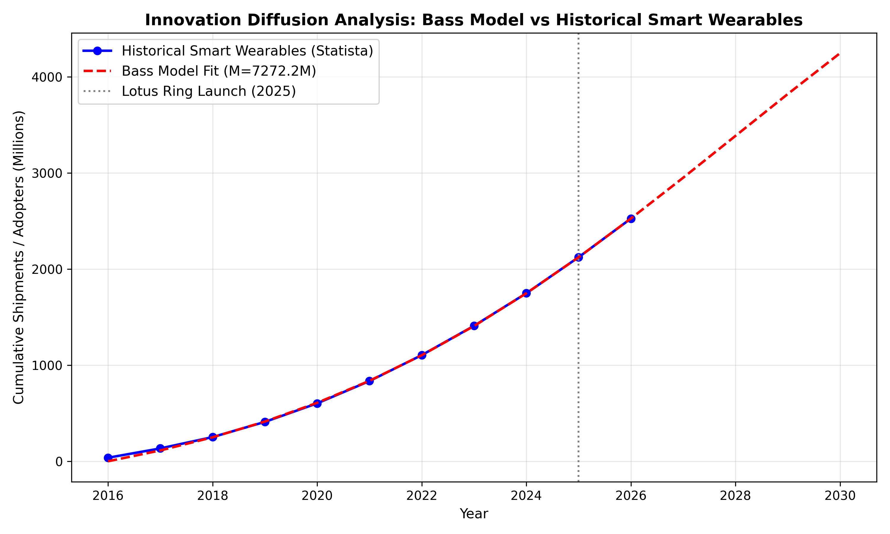

---
output:
  pdf_document: default
  html_document: default
---
# Innovation Diffusion Analysis Based on TIME's Best Innovations List

**Course:** Marketing Analytics  
**Instructor:** Sereen Sipan   
**Assignment:** Homework 1  
**Selected Innovation:** Lotus Ring (TIME's Best Inventions of 2025)  

---

## 1. Selected Innovation & Reference Link
* **Innovation Name:** Lotus Ring[cite: 1]
* **Category:** Accessibility & Smart Home[cite: 1]
* **Reference Link:** TIME Best Inventions of 2025: Lotus Ring[cite: 1]
* **Product Description:** The Lotus Ring is a wearable smart ring designed with accessibility at its core. Users press a button on the rechargeable ring and point at home devices to trigger infrared signals that control lights, televisions, and appliances without requiring internet connectivity, complex apps, or home rewiring.

---

## 2. Look-Alike Historical Innovation & Justification
* **Look-Alike Innovation Category:** General Smart Wearable Devices and Smart Wristwear (CCS Insight / Statista Dataset).
* **Justification:** 
  To analyze the adoption curve of the Lotus Ring—a breakthrough accessibility-first smart ring introduced in 2025—we utilize historical worldwide shipment data for the broader smart wearables and smart wristwear category (forecasted from 2016 to 2026 by CCS Insight). Both product categories represent wearable consumer technology designed to seamlessly integrate digital control into daily life without requiring cumbersome interfaces (such as smartphones or complex app navigation). 
  
  Just as early smartwatches and fitness trackers pioneered consumer acceptance of wrist- and finger-worn smart hardware by tracking health metrics and notifications, the Lotus Ring represents the next evolutionary phase of wearables. It shifts the primary value proposition from personal health monitoring to frictionless smart-home and accessibility control. Because brand-new innovations lack historical sales time series, utilizing the adoption trajectory of the parent smart wearable category captures the exact consumer awareness, market readiness, and diffusion dynamics required to estimate the Bass Model parameters ($p$, $q$, and $M$).
---

## 3. Historical Data Source
* **Source:** Statista (Global Smart Wearable Device Shipments Time Series).(Last updated: March 21, 2022). [cite: 2]
* **Dataset:** Smart wearable shipments forecast worldwide from 2016 to 2026 (Unit shipment forecast of smart wristwear worldwide).
* **Survey Period:** 2016 to 2021 (with forecast projections through 2026).
* **Region:** Global.
* **Summary Table (Historical & Forecast Shipments):**
  * **2016:** 37.0 million units (Cumulative: 37.0M)
  * **2017:** 97.0 million units (Cumulative: 134.0M)
  * **2018:** 118.0 million units (Cumulative: 252.0M)
  * **2019:** 158.0 million units (Cumulative: 410.0M)
  * **2020:** 193.0 million units (Cumulative: 603.0M)
  * **2021:** 232.0 million units (Cumulative: 835.0M)
  * **2022***: 270.0 million units (Cumulative: 1,105.0M)
  * **2023***: 305.0 million units (Cumulative: 1,410.0M)
  * **2024***: 339.0 million units (Cumulative: 1,749.0M)
  * **2025***: 375.0 million units (Cumulative: 2,124.0M)
  * **2026***: 402.0 million units (Cumulative: 2,526.0M)
  
*(Note: Asterisks (2022-2026) denote forecast periods provided by CCS Insight / Statista).*

---

## 4. Bass Model Parameter Estimation
Using nonlinear least squares curve fitting on cumulative historical smart wearable shipments:

- **Market Potential (M):** $7,272.17$ million units
- **Coefficient of Innovation (p):** $0.01406$
- **Coefficient of Imitation (q):** $0.21152$

---

## 5. Scope Selection & Justification
* **Chosen Scope:** **Global.**
* **Justification:** The Lotus Ring is manufactured for global distribution via e-commerce and international retail channels. Smart wearable and smart home adoption is a worldwide phenomenon spanning North America, Europe, and Asia-Pacific. Using global smart wearable shipment data captures macroeconomic trends, manufacturing scale economies, and worldwide consumer adoption behavior.

---

## 6. Diffusion Prediction & Adopters by Period
Applying the Bass Model parameters ($M = 7,272.17$, $p = 0.01406$, $q = 0.21152$), we forecast the cumulative adoption and annual sales trajectory following the Lotus Ring's launch in 2025:

- **2025 (Launch):** Cumulative = 2,123.38M
-  Annual Shipments = 374.94M
    
- **2026:** Cumulative = 2,526.98M 
-  Annual Shipments = 403.60M

- **2027:** Cumulative = 2,951.38M 
-  Annual Shipments = 424.40M
    
- **2028:** Cumulative = 3,386.82M 
- Annual Shipments = 435.44M

- **2029:** Cumulative = 3,822.45M 
- Annual Shipments = 435.63M

---

## 7. Visualization of Diffusion Path

--- 
## 8. Citations
1. https://time.com/collections/best-inventions-2025/7318226/lotus-ring/
2. https://www.statista.com/statistics/878144/worldwide-smart-wristwear-shipments-forecast/

### \textcolor{purple}{THANKS ARTUR!} 
### \textcolor{orange}{I hope your day has a nice ring to it!}
(pun intended)  